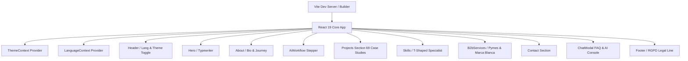
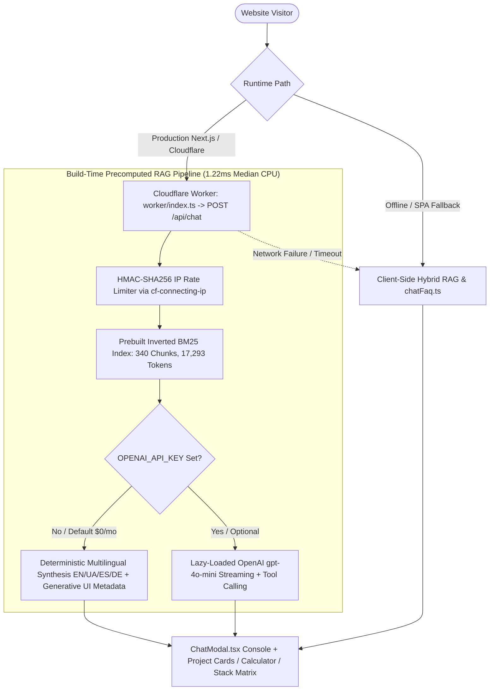

# Portfolio Architecture Specification

A technical overview of the directory structure, build system, deployment mechanisms, and runtime logic of the Artur Yusupov Portfolio Application.

---

## 1. System Architecture

The application is structured as a high-performance **Single Page Application (SPA)** using React 19, TypeScript, and Vite, running on **Node.js 24 LTS**.



---

## 2. Directory Structure

The core files and components are structured as follows:

```text
Portfolio/
├── .agents/
│   └── AGENTS.md           # Workspace Rules & AI Harness Constraints
├── .github/
│   ├── dependabot.yml      # Automated Dependency Governance
│   └── workflows/
│       └── deploy.yml      # CI/CD Automated Security & Deploy Workflow
├── src/
│   ├── assets/             # Global visual resources and images
│   ├── components/         # Modular React Components
│   │   ├── projects/       # 69 Individual project case study files
│   │   ├── About.tsx       # Bio & journey timeline
│   │   ├── AiWorkflow.tsx  # Dynamic Spec-Driven SDLC stepper
│   │   ├── B2bServices.tsx # Dual-tab B2B services (Pymes & White-Label)
│   │   ├── Header.tsx      # Sticky navigation, theme & 3-lang dropdown
│   │   ├── Skills.tsx      # T-Shaped Specialist component
│   │   ├── ChatModal.tsx   # Floating client-side FAQ bot & console
│   │   └── Footer.tsx      # Legal RGPD notice & footer links
│   ├── contexts/           # Theme (Dark/Light) & Language (i18n) providers
│   │   ├── ThemeContext.tsx
│   │   └── LanguageContext.tsx
│   ├── data/
│   │   └── chatFaq.ts      # Multilingual FAQ Chatbot database (EN/UA/ES)
│   ├── locales/            # i18n Translation dictionaries & types
│   │   ├── types.ts        # Strict Translation interface
│   │   ├── en.ts           # English translations
│   │   ├── ua.ts           # Ukrainian translations
│   │   └── es.ts           # Spanish translations
│   ├── App.tsx             # Root Layout manager
│   ├── index.css           # Tailwind v4 import & custom styles
│   └── main.tsx            # Application entrypoint mount
├── DESIGN_SYSTEM.md        # Styles, typography, and grids spec
├── SECURITY.md             # CSP, Base64 encryption, and secrets policy
├── ARCHITECTURE.md         # Current file (System overview)
└── package.json            # Dependencies and scripts definitions
```

---

## 3. Runtime Logic & Navigation

### Theme Context
- A React Context (`ThemeContext`) controls dark-mode state by toggling the `.dark` class on the root `document.documentElement` element.
- Tailwind CSS v4 custom variant rules map the `.dark` selector to apply dark-themed styles (`dark:bg-*`, `dark:text-*`).

### Internationalization (i18n) Subsystem
- Driven by a custom `LanguageContext` providing strict type-checked translations via `useLanguage()`.
- **Supported Languages:** 4 languages - English (`en`), Ukrainian (`ua`), Spanish (`es`), and German (`de`).
- **Header Language Switcher:** A 4-language interactive dropdown menu (`EN`, `UA`, `ES`, `DE`) with custom SVG flag icons and click-outside dismissal.
- **Auto-Detection:** Detects visitor's browser language on first load (`navigator.language`).
- **Persistence:** Persists language preference in `localStorage.portfolio_lang`.
- **Localization:** Supports `en.ts`, `ua.ts`, `es.ts`, and `de.ts` translation dictionaries. Project case studies include localized descriptions across all 4 locales.

### Smooth Scroll Navigation
- Navigation uses standard HTML `#anchor` links mapped to section `id`s.
- Active states are tracked via scroll event listeners on window offsets, automatically highlighting the corresponding header menu item.

### Client-Side Multilingual FAQ Chatbot
- Driven by a keyword-matching algorithm inside `src/data/chatFaq.ts`.
- Supports trilingual FAQ matching (`question`, `questionUa`, `questionEs` & `answer`, `answerUa`, `answerEs`), returning localized answers via `getBotAnswer(question, lang)`.

---

### View Transitions Navigation Architecture
- **Native W3C Standard:** State transitions between the project grid and `ProjectDetail.tsx` are wrapped in `document.startViewTransition()` with strict TypeScript bindings and graceful non-blocking fallback.
- **Hardware GPU Morphing:** `viewTransitionName: 'project-thumb-${project.id}'` seamlessly morphs thumbnails into full case study banners at 120 FPS with 0 KB external library overhead.
- **Project Card Architecture:** Displays curated top 4 technologies with an interactive `+N` / `- less` toggle per card, fixed 3-line description clamping (`line-clamp-3`), and sticky bottom CTA alignment.

### Progressive Web App (PWA) & Offline Subsystem
- **Web App Manifest (`public/manifest.webmanifest`):** Declares standalone display mode, orientation, brand colors (`#0f172a` / `#7c3aed`), and 192x192/512x512/maskable app icons for native mobile (iOS/Android) and desktop home-screen installation.
- **Service Worker (`public/sw.js`):** Implements a **Stale-While-Revalidate** caching strategy with CacheStorage API, enabling instant sub-second page loads and offline case study navigation with automated background cache invalidation.

### Spec-Driven AI Harness Engineering (SDD 2026 Architecture)
- **Immutable Constitution:** Governed by [`.specify/memory/constitution.md`](file:///d:/PORTFOLIO/Portfolio/.specify/memory/constitution.md), establishing permanent non-negotiable standards (Zero-`any`, Base64 security, CWV budgets, i18n parity, WCAG 2.2 AA / EAA 2026).
- **Rules Layer:** Always-active workspace boundaries in [`.agents/rules/project-context.md`](file:///d:/PORTFOLIO/Portfolio/.agents/rules/project-context.md) and [`.agents/rules/code-style.md`](file:///d:/PORTFOLIO/Portfolio/.agents/rules/code-style.md).
- **Modular Skills Catalog:** On-demand procedural modules in [`.agents/skills/`](file:///d:/PORTFOLIO/Portfolio/.agents/skills/) (`tdd-react`, `a11y-wcag22`, `perf-cwv`, `i18n-locales`, `seo-pseo`) compatible across Antigravity, Claude Code, and Cursor.
- **Isolated Feature Specs:** Lifecycle-governed feature development managed in `specs/<feature-slug>/` (`spec.md`, `plan.md`, `tasks.md`, `analysis.md`).
- **Deterministic Verification:** Every automated step enforces SAST (TypeScript strict compilation, ESLint 10), SCA (production dependency audits), and sub-second bundle budget guardrails.

---

## 4. Build, CI/CD, & Deploy Pipeline

The repository operates a **dual-target CI/CD architecture** on **Node.js 24 LTS** and **pnpm 11** (global NTFS content-addressable store at `D:\.pnpm-store`), triggered automatically on every push to `master`. For full Cloudflare runtime, DNS, SSL/TLS, and quota details, see [`specs/cloudflare-workers-deployment/spec.md`](file:///d:/PORTFOLIO/Portfolio/specs/cloudflare-workers-deployment/spec.md).

### 4.1. Primary Production: Cloudflare Workers + Static Assets (`https://www.yusupovartur.com`)
- **Automated Builds (Cloudflare Workers Builds):** Connected directly to `YusupovWebArt/Portfolio` (`master`).
  1. Executes `pnpm run build:cf` (`scripts/build-cf-workers.mjs`):
     - Regenerates the build-time precomputed inverted BM25 RAG index (`scripts/generate-rag-index.mjs` -> `src/lib/ai/generated/rag-index.generated.ts`).
     - Temporarily isolates `app/api` and `proxy.ts` (restored via `finally` and signal traps) and runs `CF_STATIC_EXPORT=1 next build` to export 520 localized static pages (`en`, `ua`, `es`, `de`) into `./out`.
     - Verifies all 13 critical export artifacts (`en/ua/es/de.html`, `404.html`, `sitemap.xml`, `robots.txt`, `feed.xml`, `llms.txt`, `llms-full.txt`, IndexNow key, `_headers`, `_redirects`).
  2. Executes `npx wrangler deploy` (`wrangler.jsonc`), uploading 5,751 static files to **Cloudflare Static Assets** (unlimited bandwidth, 0 Worker invocations) and deploying `worker/index.ts` (~1.57 MiB gzipped) exclusively for `/api/*` (`run_worker_first: ["/api/*"]`).
- **Edge Routing & TLS:**
  - Root apex `yusupovartur.com` (`AAAA 100::`, Proxied) redirects `301` to `https://www.yusupovartur.com/${1}` with query-string preservation.
  - `www.yusupovartur.com` routes directly to the `yusupovartur-portfolio` Worker + Static Assets with `SSL/TLS Full`, `Always Use HTTPS`, and `Bot Fight Mode` enabled.

### 4.2. Secondary SPA Mirror: GitHub Actions -> GitHub Pages (`https://yusupovwebart.github.io/Portfolio/`)
- **Continuous Integration (`.github/workflows/deploy.yml`):** On every push or pull request to `master`:
  0. Executes **Gitleaks** secret scan on the working tree.
  1. Installs deterministic dependencies (`pnpm install --frozen-lockfile`) on Node.js 24 LTS + `pnpm`.
  2. Executes SAST: Type checks (`pnpm exec tsc --noEmit`) and lints (`pnpm lint`).
  3. Executes TDD test suite (`pnpm test`, 44 files / 249 tests).
  4. Executes SCA: Production vulnerability audit (`pnpm audit --prod --audit-level=high`).
  5. Compiles Vite/Rolldown production bundle (`pnpm build`) and runs built-output contact leak scan (`node scripts/check-contact-leak.mjs`).
  6. Runs Playwright E2E + axe-core WCAG 2.2 AA accessibility tests (`pnpm test:e2e`) and Lighthouse CI (`pnpm audit:lhci`).
  7. On `master` push, deploys `dist/` to the `gh-pages` branch via `${{ secrets.GITHUB_TOKEN }}`.

---

## 5. Autonomous Hybrid RAG AI Chatbot Architecture (Implemented)

The portfolio runs a production **Autonomous Hybrid RAG (Retrieval-Augmented Generation)** assistant across both Cloudflare Workers (`/api/chat`) and the static SPA fallback (`ChatModal.tsx`):



### Implemented Architecture Highlights:
1. **Build-Time Precomputation (`scripts/generate-rag-index.mjs`):** Pre-indexes 71 projects, faceted subchunks, 5 services, profile, methodology, and 47 engineering blog summaries (omitting ~3.4 MB of raw Markdown bodies) into `src/lib/ai/generated/rag-index.generated.ts`.
2. **Sub-2ms Edge Retrieval (`src/lib/ai/rag.ts`):** Uses a flat inverted BM25 index with `Float64Array` accumulators, TF-IDF cosine similarity, zero-allocation Damerau-Levenshtein typo tolerance, O(1) slug maps, and bounded query memoization (verified `1.22 ms` median CPU on Cloudflare Workers Free).
3. **Generative UI Metadata (`X-Chat-Metadata`):** Server computes structured project cards, stack comparison triggers, timeline calculator triggers, service cards, and contextual follow-ups so the browser avoids downloading the RAG dataset.
4. **Security Enforcement:** Implements all 6 defense tiers defined in [**`SECURITY.md` (Section 7)**](file:///d:/PORTFOLIO/Portfolio/SECURITY.md#7-hybrid-rag-architecture-security-implementation-ai-chatbot).

---

## 6. Analytics, Telemetry & Search Engine Infrastructure (GA4 & GSC)

### Privacy-Preserving GA4 Telemetry (Consent Mode v2 Basic)
- **Zero Pre-Consent Dispatches:** By default, Google Consent Mode v2 initializes with `ad_storage: denied`, `analytics_storage: denied`, `ad_user_data: denied`, and `ad_personalization: denied`. No tracking cookies or network requests reach Google servers until the user provides explicit opt-in through `ConsentModal.tsx`.
- **SSR-Safe Hydration:** Consent state is synchronized via React 19 `useSyncExternalStore` in `ConsentContext.tsx`, eliminating SSR hydration mismatches across static Next.js 16 routes.
- **14-Month Data Retention:** Configured in the `Webart React Portfolio` (`yusupovartur.com`) property to preserve user and event cohorts for up to 14 months for long-term funnel analysis.
- **Enhanced Measurement:** Captures page views across client-side App Router history state changes, outbound link clicks, file downloads, and 90% scroll depth.

### Event Taxonomy & Custom Dimensions
- **Key Events (Conversions):**
  - `contact_click`: Triggered when visitors initiate communication via Telegram, Email, WhatsApp, LinkedIn, or GitHub.
  - `cv_download`: Triggered when visitors download Artur Yusupov CV PDF from any UI component.
- **Custom Dimensions (Event-Scoped):**
  - `Contact Channel` (`contact_channel`): Categorizes the specific platform selected (`telegram`, `email`, `whatsapp`, `linkedin`, `github`).
  - `Download Source` (`download_source`): Categorizes the UI origin initiating the CV download (`hero`, `header`, `about`, `footer`, `skills`).
  - `Chat Action` (`chat_action`): Categorizes interactions with the Hybrid RAG AI chat assistant (`open`, `close`, `suggestion_click`, `ask_question`, `tool_call`).

### Google Search Console (GSC) Domain Property Integration
- **DNS-Verified Domain Property:** Configured under `sc-domain:yusupovartur.com`, aggregating search performance across all subdomains and protocol variants.
- **Direct GA4 Link:** GSC is linked directly to GA4 stream `Artur Yusupov Production`, feeding Organic Google Search impressions, clicks, search queries, and landing page metrics directly into GA4 reports.
- **Automated Multilingual XML Sitemap:** Built on Next.js 16 App Router `app/sitemap.ts`, serving `https://www.yusupovartur.com/sitemap.xml` with 512+ discovered URLs across 4 localized variants (`en`, `ua`, `es`, `de` + `x-default`) with bidirectional hreflang annotations.
- **Proactive 4xx Resolution:** Automated verification and remediation of crawl anomalies and historical draft slugs.

### Zero-Commit Secrets Compliance
- In accordance with `SECURITY.md`, the repository remains 100% public-safe: zero private Google service keys, OAuth tokens, DNS registrar credentials, or Measurement Protocol API secrets are stored in code or specifications. Public client identifiers (`G-STZ8DN2KND`) operate exclusively within browser-safe boundaries.

