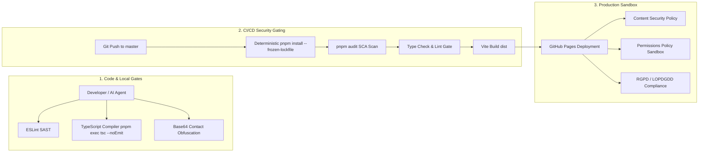

# Portfolio Security Policy & DevSecOps Specification

This document details the security architecture, DevSecOps pipelines, automated compliance gates, secret management policies, and runtime protections implemented across the Artur Yusupov Portfolio Application.

---

## DevSecOps Pipeline Architecture

Security is integrated across the entire Software Development Life Cycle (SDLC), from local development and agentic AI coding to automated CI/CD gating and production client execution.

---

## 1. Zero-Commit Credentials & Secret Management

- **No Secrets in Code:** Under no circumstances should API keys, private domains, database passwords, or personal credentials be written directly into source files.
- **Environment Variables:** All environment-specific variables must reside in a `.env` file (strictly excluded via `.gitignore`) and accessed exclusively via `import.meta.env.*`.
- **Zero-Commit Social Promotion & Marketing Assets:** Personal social media promotion plans, content calendars, outreach drafts, spreadsheets, and promotional graphics containing plaintext contact details are strictly local operational artifacts. They must reside exclusively inside gitignored paths (`docs/marketing/`) or external local workspaces, and must NEVER be committed to Git or disclosed inside public repository specifications.
- **Git History Auditing:** If a credential is ever committed, it must be purged by rewriting git history (e.g., via `git filter-repo`), as simple deletion commits retain the secret in past commit trees.

---

## 2. Static Application Security Testing (SAST) & Type Safety

- **Strict Type Checking (Zero `any` Policy):** All components, props, state, and utility functions must be strictly typed. Proposal of new code additions requires passing `pnpm exec tsc --noEmit` with zero errors.
- **Linting & React Hooks Guardrails:** `eslint` validates adherence to modern ECMAScript standards and enforces React Hook rules (`eslint-plugin-react-hooks`).
- **AI Agent Workspace Harness:** The project rules defined in `.agents/AGENTS.md` force all AI coding assistants (Antigravity, Claude Code, Cursor) to run static analysis and linting before proposing or merging modifications.

---

## 3. Software Composition Analysis (SCA) & Dependency Governance

- **Continuous Vulnerability Scanning:** Every package installation and CI run audits the dependency tree via `pnpm audit --prod --audit-level=high` (Targeting 0 production vulnerabilities).
- **Automated Dependabot Lifecycle:** Configured in [`.github/dependabot.yml`](file:///.github/dependabot.yml) to scan weekly:
  - **Grouped Updates:** Minor and patch updates are grouped into unified PRs to prevent dependency drift.
  - **Breaking Change Pinning:** Core compilers and layout dependencies with breaking migrations (e.g., `typescript >= 7.0.0`) are pinned to preserve build stability. Icons are served exclusively by `react-icons` (Lucide, Font Awesome, and Simple Icons sets) to keep a single icon dependency.

---

## 4. Edge & Client-Side App Hardening (HTTP Security Headers)

Production (`https://www.yusupovartur.com`) enforces all 7 mandatory HTTP security headers at the Cloudflare Edge via [`public/_headers`](file:///d:/PORTFOLIO/Portfolio/public/_headers) (for Static Assets) and [`worker/index.ts`](file:///d:/PORTFOLIO/Portfolio/worker/index.ts) (for `/api/chat`, plus `Cache-Control: no-store, max-age=0`), while the GitHub Pages SPA mirror reinforces CSP/Referrer/Permissions policies via `<meta>` tags in [`index.html`](file:///d:/PORTFOLIO/Portfolio/index.html):

1. **Strict-Transport-Security (HSTS) & Always Use HTTPS:**
   - Emits `Strict-Transport-Security: max-age=63072000; includeSubDomains; preload` on production responses, paired with Cloudflare **Always Use HTTPS** and **SSL/TLS Full** (TLS 1.3).
2. **Content Security Policy (CSP):**
   - Restricts script and stylesheet execution to `'self'` and explicitly allowlisted vendors (Google Tag Manager, Google Analytics).
   - Blocks unauthorized `iframe` and `object` embeds (`frame-src 'none'; object-src 'none'`).
3. **Anti-Clickjacking & MIME Sniffing Protection:**
   - Enforces `X-Frame-Options: DENY`, `X-Content-Type-Options: nosniff`, and `Cross-Origin-Opener-Policy: same-origin`.
4. **Referrer Policy:**
   - Set to `strict-origin-when-cross-origin` to strip full URL paths and query parameters during external transitions.
5. **Permissions Policy:**
   - Explicitly revokes browser access to sensitive hardware APIs: `camera=(), microphone=(), geolocation=(), payment=(), usb=(), browsing-topics=()`.
6. **Edge WAF & Bot Protection:**
   - Cloudflare **Bot Fight Mode** and **Cloudflare Managed Ruleset** are enabled on the `yusupovartur.com` zone.

---

## 5. Anti-Scraping & Personal Data Obfuscation

To protect email addresses, phone numbers, and messaging handles from automated scraping bots and spam crawlers:

- **Encoding:** Contact URLs and identifiers are stored as Base64-encoded strings (e.g., `YWJjQGV4YW1wbGUuY29t`).
- **Dynamic Runtime Decryption:** React components decode contact details dynamically at runtime:
  - Decoding triggers strictly upon user interaction (mouse hover or click).
  - Obfuscated values are injected into the DOM tree only at the moment of interaction, preventing static web crawlers from extracting raw text from the initial HTML payload.
- **Crawler Fallback:** A `<noscript>` wrapper inside `#seo-fallback` presents indexable text descriptions for SEO crawlers while strictly avoiding raw, scrapable `mailto:` or `tel:` links.

---

## 6. CI/CD Automated Security Gating (GitHub Actions & Cloudflare Workers Builds)

1. **GitHub Actions ([`.github/workflows/deploy.yml`](file:///d:/PORTFOLIO/Portfolio/.github/workflows/deploy.yml)):** Every push and PR to `master` executes a 9-stage automated gate before deploying the SPA mirror to `gh-pages`:
   - **Gitleaks Secret Scan:** Scans the working tree for leaked credentials.
   - **Deterministic Dependency Installation:** `pnpm install --frozen-lockfile` on Node.js 24 LTS.
   - **SAST Compilation & Lint Gates:** `pnpm exec tsc --noEmit` (zero-`any`) and `pnpm lint`.
   - **TDD Verification Gate:** `pnpm test` (Vitest unit, component, security, and Cloudflare Worker specs).
   - **SCA Vulnerability Gate:** `pnpm audit --prod --audit-level=high`.
   - **Built-Output Contact Leak Gate:** `pnpm build` + `node scripts/check-contact-leak.mjs`.
   - **E2E, A11y & CWV Gates:** Playwright E2E + axe-core WCAG 2.2 AA (`pnpm test:e2e`) and Lighthouse CI (`pnpm audit:lhci`).
2. **Cloudflare Workers Builds (`www.yusupovartur.com`):** Every push to `master` runs `pnpm run build:cf` (`scripts/build-cf-workers.mjs`, including RAG index generation and 13-file static output verification) followed by `npx wrangler deploy`.

---

## 7. Hybrid RAG Architecture Security Implementation (AI Chatbot)

The production serverless **Hybrid RAG** endpoint (`POST /api/chat` in [`worker/index.ts`](file:///d:/PORTFOLIO/Portfolio/worker/index.ts) and [`app/api/chat/route.ts`](file:///d:/PORTFOLIO/Portfolio/app/api/chat/route.ts)) enforces all 6 defense tiers:

### Tier 1: Zero-Commit Secret Protection (Cloudflare Secrets)
- **Enforcement:** Runtime secrets (`RATE_LIMIT_SALT` and optional `OPENAI_API_KEY` / Upstash tokens) are never committed to Git or exposed to the client. They are stored exclusively as encrypted Cloudflare Worker Secrets and synchronized into `process.env` at request time inside `worker/index.ts`.

### Tier 2: Domain Whitelisting & Method Restriction
- **Enforcement:** `worker/index.ts` rejects non-`POST` methods with `405 Method Not Allowed`. `app/api/chat/route.ts` strictly validates the `Origin` header in production against `https://yusupovartur.com`, `https://www.yusupovartur.com`, and `https://yusupovwebart.github.io`, returning `403 Forbidden` for unauthorized origins.

### Tier 3: Abuse Prevention & Payload Clamping
- **Enforcement:**
  - **IP-Based Rate Limiting:** Resolves client IP with `cf-connecting-ip` highest priority, pseudonymizes it with HMAC-SHA256 (`RATE_LIMIT_SALT`), and enforces `15 requests / hour` per hashed identifier (in-memory bounded store with optional Upstash Redis Lua script).
  - **Payload & Role Validation:** Rejects bodies over `16 KB` (`413`), messages over `1,200` chars (`400`), and non-`user`/`assistant` roles such as `role: 'system'` (`400`), clipping history to the last 8 messages.

### Tier 4: Prompt Injection Guardrails & Grounding (AI Safety)
- **Enforcement:**
  - `sanitizeLlmInput()` strips `<system>` blocks, HTML/XML breakout tags, control characters, and multilingual prompt-override phrases.
  - `buildSystemPrompt()` wraps retrieved chunks in `<context>` tags with strict factual grounding boundaries and zero-em-dash rules.

### Tier 5: EU RGPD / LOPDGDD Privacy Compliance
- **Enforcement:**
  - **Zero-Log Architecture:** Chat queries are processed ephemerally in-memory without persisting raw visitor IPs or chat transcripts to any database.
  - Contact data remains Base64-obfuscated across all retrieval and UI pipelines.

### Tier 6: Resilient Fallback (Graceful Degradation)
- **Enforcement:** When `OPENAI_API_KEY` is unset (default `$0/mo` mode), `/api/chat` executes deterministic multilingual Hybrid RAG synthesis directly on Cloudflare Edge (`1.22 ms` median CPU). If the network or API is unreachable, `ChatModal.tsx` falls back transparently to the local client-side engine.

---

## 8. European Regulatory & Privacy Compliance (RGPD / LOPDGDD)

- **Privacy & Consent Architecture:** The site operates without non-essential tracking cookies until explicit opt-in consent is provided. Google Analytics (GA4) runs strictly under Consent Mode v2 Basic mode.
- **Anonymized Analytics:** Google Analytics (GA4) is configured with IP anonymization and respects user privacy preferences.
- **EU Invoicing & Legal Footprint:** The footer explicitly declares business and tax invoicing compatibility for professionals and companies in Spain and the European Union.

