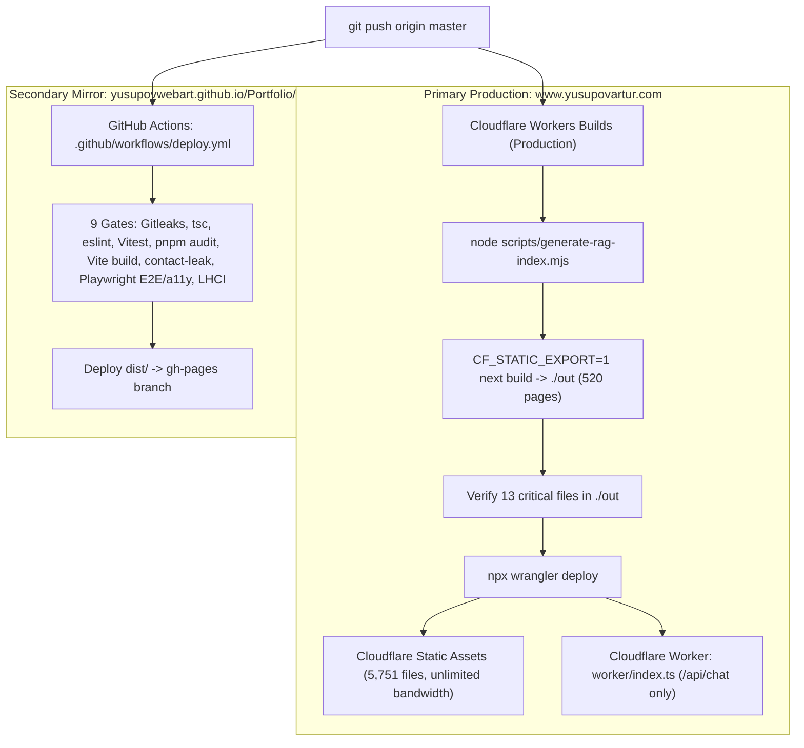

# Specification: Cloudflare Workers + Static Assets Deployment & Dual CI/CD Architecture

- **Feature Slug:** `cloudflare-workers-deployment`
- **Status:** Implemented & Verified in Production
- **Primary Production URL:** `https://www.yusupovartur.com`
- **Secondary SPA Mirror:** `https://yusupovwebart.github.io/Portfolio/`
- **Hosting Cost:** `$0/month` (Cloudflare Workers Free + Static Assets + GitHub Pages)
- **Last Verified:** 2026-11-27

---

## 1. Context & Architectural Decision

Previously, the Next.js 16 production site was hosted on Vercel Hobby, which enforces a hard account-wide **10 GB Fast Origin Transfer** monthly cap and pauses all projects in the team for the remainder of the billing cycle if any single project breaches quota.

To guarantee uninterrupted production availability, unlimited static asset bandwidth, and zero recurring hosting costs, `www.yusupovartur.com` was migrated to **Cloudflare Workers + Static Assets** (`yusupovartur-portfolio`), while retaining the automated **GitHub Actions -> GitHub Pages** pipeline for the Vite SPA mirror.

---

## 2. Dual-Target CI/CD Pipeline

Every push to `master` triggers two independent automated pipelines:



### 2.1. Primary Production CI/CD (Cloudflare Workers Builds)

- **Repository:** `YusupovWebArt/Portfolio` (branch: `master`)
- **Worker Name:** `yusupovartur-portfolio`
- **Build Command:** `pnpm run build:cf` (executes `node scripts/build-cf-workers.mjs`)
- **Deploy Command:** `npx wrangler deploy`
- **Typical Build Duration:** `~1m 35s` (`~1.5` build minutes out of `3,000` free minutes/month)

#### What `scripts/build-cf-workers.mjs` Executes
1. **Prebuilt RAG Index Generation:** Runs `node scripts/generate-rag-index.mjs` to compile all 71 projects, project facets, profile, 5 services, methodology, and 47 blog posts into `src/lib/ai/generated/rag-index.generated.ts` (340 chunks, 17,293 indexed tokens in a flat inverted BM25 index, and 47 lightweight blog summaries without full Markdown bodies).
2. **Safe Static Export Isolation:** Temporarily moves `app/api` -> `.cf-tmp-api` and `proxy.ts` -> `.cf-tmp-proxy.ts` (because Next.js `output: 'export'` rejects `force-dynamic` route handlers and root proxy middleware), with automatic restoration in `finally` and `SIGINT`/`SIGTERM` handlers.
3. **Next.js 16 Static Export:** Runs `CF_STATIC_EXPORT=1 NODE_ENV=production pnpm exec next build`, generating 520 static localized HTML pages (`en`, `ua`, `es`, `de`), XML sitemaps, RSS feed, and static assets into `./out`.
4. **Output Verification Gate:** Asserts the presence of all 13 critical files in `./out`:
   - `en.html`, `ua.html`, `es.html`, `de.html`, `404.html`
   - `sitemap.xml`, `robots.txt`, `feed.xml`
   - `llms.txt`, `llms-full.txt`, `yusupovartur-indexnow-2026-v1.txt`
   - `_headers`, `_redirects`
5. **Wrangler Deployment:** `npx wrangler deploy` reads `wrangler.jsonc`, uploads `./out` to Cloudflare Static Assets, and bundles `worker/index.ts` (~1.57 MiB gzipped vs 3 MiB Free limit).

### 2.2. Secondary Mirror CI/CD (GitHub Actions -> GitHub Pages)

Configured in `.github/workflows/deploy.yml` on push/PR to `master` (Node.js 24 LTS, `pnpm@11`, `--frozen-lockfile`):
0. **Gitleaks** secret scan (`v8.24.0`, SHA-256 verified binary)
1. **SAST TypeScript:** `pnpm exec tsc --noEmit` (strict zero-`any`)
2. **SAST Linting:** `pnpm lint` (ESLint 10)
3. **TDD Unit & Component Suite:** `pnpm test` (Vitest, 44 files / 249 tests)
4. **SCA Dependency Audit:** `pnpm audit --prod --audit-level=high`
5. **Vite Production Build & Leak Scan:** `pnpm build` + `node scripts/check-contact-leak.mjs`
6. **Playwright E2E & WCAG 2.2 AA / EAA 2026 Accessibility:** `pnpm test:e2e`
7. **Lighthouse CI (CWV):** `pnpm audit:lhci`
8. **Deployment (`master` push only):** Publishes `dist/` to the `gh-pages` branch via `JamesIves/github-pages-deploy-action`.

---

## 3. Cloudflare Runtime Configuration

### 3.1. `wrangler.jsonc`

```json
{
  "name": "yusupovartur-portfolio",
  "main": "worker/index.ts",
  "compatibility_date": "2026-11-24",
  "compatibility_flags": ["nodejs_compat"],
  "assets": {
    "directory": "./out",
    "binding": "ASSETS",
    "html_handling": "drop-trailing-slash",
    "not_found_handling": "404-page",
    "run_worker_first": ["/api/*"]
  },
  "observability": {
    "enabled": true
  }
}
```

- **`run_worker_first: ["/api/*"]`:** Ensures 99.5%+ of requests (all HTML pages, images, JS/CSS, sitemaps, RSS, `llms.txt`) are served directly by **Cloudflare Static Assets** without invoking the Worker script or consuming daily Worker invocation quotas.
- **`html_handling: "drop-trailing-slash"`:** Preserves canonical clean URLs (`/en`, `/en/blog/...`, `/en/projects/...`).
- **`not_found_handling: "404-page"`:** Serves `./out/404.html` with HTTP `404` for nonexistent routes.

### 3.2. Worker Entrypoint (`worker/index.ts`) & `/api/chat`

- Routes `POST /api/chat` to `app/api/chat/route.ts`.
- Rejects any non-`POST` method on `/api/chat` with `405 Method Not Allowed` (`Allow: POST`).
- Synchronizes Worker runtime secrets (`RATE_LIMIT_SALT`, and optional `OPENAI_API_KEY`, `UPSTASH_REDIS_REST_URL`, `UPSTASH_REDIS_REST_TOKEN`, `NEXT_PUBLIC_SITE_URL`) into `process.env`.
- Enforces all mandatory security headers plus `Cache-Control: no-store, max-age=0` on every API response.
- Prioritizes `cf-connecting-ip` for HMAC-SHA256 IP rate limiting (`15 req/hour` per hashed IP).
- Falls back to `env.ASSETS.fetch(request)` for any non-API path.

### 3.3. Build-Time Precomputed RAG Performance Profile

To stay comfortably inside the Cloudflare Workers Free **10 ms CPU time** budget:
- All knowledge chunks and the inverted BM25 index are prebuilt at build time (`src/lib/ai/generated/rag-index.generated.ts`).
- `src/lib/ai/rag.ts` uses `Float64Array` accumulators, O(1) `Map` lookups, bounded per-isolate query memoization, pre-folded titles/FAQ strings, and zero-allocation scratch buffers for Damerau-Levenshtein fuzzy matching.
- `src/data/chatFaq.ts` short-circuits `matchesFaqKeyword` via `indexOf` + cached Unicode `RegExp` instances.
- `app/api/chat/route.ts` skips unused OpenAI prompt assembly and lazy-loads `@ai-sdk/openai`, `ai`, and `src/lib/ai/tools` only when `OPENAI_API_KEY` is configured.
- **Verified Production Metrics (Cloudflare Edge, deployment `355b980e`):**
  - Median CPU Time: **`1.22 ms`** (reduced from `206 ms` cold start, ~168x faster)
  - Wall Time: **`11 ms`**
  - Memory Usage: **P50 `17.93 MB` / P90 `24.63 MB`** (Free limit: `128 MB`)
  - Errors: **`0`** (`0` CPU limit, `0` memory, `0` uncaught exceptions)

### 3.4. Static Headers & Redirects (`public/_headers` and `public/_redirects`)

- **`public/_headers`:** Applies all 7 mandatory security headers (`Strict-Transport-Security`, `Content-Security-Policy`, `X-Content-Type-Options`, `X-Frame-Options`, `Referrer-Policy`, `Permissions-Policy`, `Cross-Origin-Opener-Policy`) across `/*`, plus long-term immutable caching for `/_next/static/*` and `/images/*`.
- **`public/_redirects`:**
  - Permanent `308` root redirect `/` -> `/en`
  - Permanent `308` legacy slug redirects (`wpskills` -> `fullstack-ai-lab`, `all-day-medical-care-clinic` -> `alldaymedicalcare`) across all 4 locales (`en`, `ua`, `es`, `de`) and non-locale fallbacks
  - Asset compatibility rewrite `/Portfolio/* /:splat 200`

---

## 4. Cloudflare Dashboard Configuration (DNS, Rules, SSL/TLS, WAF, Secrets)

### 4.1. DNS Records (`yusupovartur.com`)

- `www.yusupovartur.com` | `Worker` | `yusupovartur-portfolio` | **Proxied** (auto-managed via Worker Custom Domain)
- `yusupovartur.com` | `AAAA` | `100::` | **Proxied** (dummy origin record backing the root-to-www Redirect Rule)
- Email & Verification Records (preserved intact, `DNS only`):
  - 5 Brevo CNAME records (`brevo1._domainkey`, `brevo2._domainkey`, `img.mail`, `mail`, `r.mail`)
  - 3 Cloudflare Email Routing MX records (`route1/2/3.mx.cloudflare.net`)
  - 5 TXT records (DKIM `cf2024-1._domainkey`, DMARC `_dmarc`, `brevo-code`, SPF `v=spf1 include:_spf.mx.cloudflare.net ~all`, `google-site-verification`)
- All legacy `_vercel` TXT verification records and Vercel project `portfolio` have been removed.

### 4.2. Redirect Rules (Zone Level)

- **Rule Name:** `Redirect from root to WWW`
- **Match:** Wildcard pattern `https://yusupovartur.com/*`
- **Target URL:** `https://www.yusupovartur.com/${1}`
- **Status Code:** `301 - Permanent Redirect`
- **Preserve query string:** Enabled (preserves UTM parameters and deep-link flags like `?chat=estimator`)

### 4.3. SSL/TLS & Security (Zone Level)

- **SSL/TLS Encryption Mode:** `Full` (Automatic mode, TLS 1.3)
- **Always Use HTTPS:** **Enabled** (redirects all `http://` traffic to `https://`)
- **Cloudflare HSTS Toggle:** **Disabled** (HSTS is emitted directly by `public/_headers` and `worker/index.ts` to avoid duplicate headers)
- **Bot Fight Mode:** **Enabled**
- **Cloudflare Managed Ruleset:** **Always Active**
- **AI Labyrinth:** **Disabled** (intentionally off to avoid interfering with legitimate GEO/AI crawlers reading `llms.txt`)

### 4.4. Worker Secrets (Zero-Commit Policy)

- Configured exclusively in Cloudflare Workers Settings (encrypted, never committed to Git):
  - `RATE_LIMIT_SALT`: 64-char random hex secret for HMAC-SHA256 IP pseudonymization.
- Optional secrets (not required for `$0/mo` autonomous Hybrid RAG mode):
  - `OPENAI_API_KEY` (enables live `gpt-4o-mini` streaming when set)
  - `UPSTASH_REDIS_REST_URL` / `UPSTASH_REDIS_REST_TOKEN` (distributed rate limiting across isolates)

### 4.5. External & Edge Observability (SRE Monitoring)

- **UptimeRobot (External 24/7 Synthetic Monitoring):** Independently probes `https://www.yusupovartur.com` over HTTP/HTTPS and SSL to alert immediately on any downtime, including account-level hosting pauses that internal provider dashboards may not surface.
- **Cloudflare Workers Observability:** Enabled in `wrangler.jsonc` (`observability.enabled: true`) for real-time CPU time, Wall time, Memory P50/P90, Error counts, and live Worker logs.
- **Post-Deploy Live Smoke Verifier:** `pnpm verify:live https://www.yusupovartur.com/en` (`scripts/verify-live-deployment.mjs`) validates HTTP 200 status and all 7 mandatory HTTP security headers.
- **Dependency & Privacy Hygiene:** Weekly grouped PRs via GitHub Dependabot (`.github/dependabot.yml`), self-hosted GDPR/DSGVO variable fonts (`@fontsource-variable/plus-jakarta-sans` and `@fontsource-variable/jetbrains-mono` with zero Google Fonts requests), and PWA Stale-While-Revalidate caching (`public/sw.js`).

---

## 5. Free-Tier Capacity & Operational Runbooks

### 5.1. Cloudflare Workers Free Plan Headroom

| Resource | Free Plan Quota | Current Usage | Operational Headroom |
| :--- | :--- | :--- | :--- |
| Static Assets Bandwidth & Requests | Unlimited | ~99.5% of traffic | Hundreds of thousands to millions of monthly pageviews |
| Static Asset File Count | 20,000 files (max 25 MiB/file) | 5,751 files | ~3.5x content growth capacity |
| Worker Invocations (`/api/chat`) | 100,000 / day (account-wide, resets 00:00 UTC) | Only AI chat POST requests | ~20,000 active chat users / day |
| Worker CPU Time / Invocation | 10 ms | 1.22 ms median | ~8x safety margin |
| Worker Memory / Isolate | 128 MB | 17.93 MB P50 / 24.63 MB P90 | ~5x safety margin |
| Worker Bundle Size (gzip) | 3 MiB | 1.57 MiB | ~1.43 MiB remaining |
| Workers Build Minutes | 3,000 min / month (account-wide) | ~1.5 min / deploy | ~2,000 deploys / month |

### 5.2. Local & Production Commands

- Regenerate prebuilt BM25 RAG index: `pnpm generate:rag-index`
- Build Cloudflare static export + verify 13 outputs: `pnpm build:cf`
- Preview Worker + Static Assets locally: `pnpm preview:cf`
- Manual deploy from CLI (normally automatic on `git push origin master`): `pnpm deploy:cf`
- Verify live production security headers and status: `pnpm verify:live https://www.yusupovartur.com/en`
- Submit updated URLs to Bing/IndexNow: `pnpm ping:indexnow --all` (or pass specific URLs)

### 5.3. Release Checklist When Adding Blog Posts or Projects

1. Add/register the new project (`src/lib/projectRegistry.ts`) or blog post (`src/data/blog/index.ts`).
2. For blog posts, run `pnpm generate:blog-og` to render the `1200x630` PNG OG cover into `public/images/blog/og/`.
3. Run `pnpm generate:llms` to refresh `public/llms.txt` and `public/llms-full.txt`.
4. Run `pnpm generate:rag-index` to refresh `src/lib/ai/generated/rag-index.generated.ts` (also auto-executed during `pnpm build:cf`).
5. Run verification gates: `pnpm exec tsc --noEmit`, `pnpm lint`, and `pnpm test`.
6. Commit and push to `origin/master` -> Cloudflare Workers Builds and GitHub Actions deploy automatically.
7. Optionally ping IndexNow via `pnpm ping:indexnow <url>` after deployment completes.
